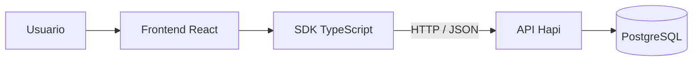
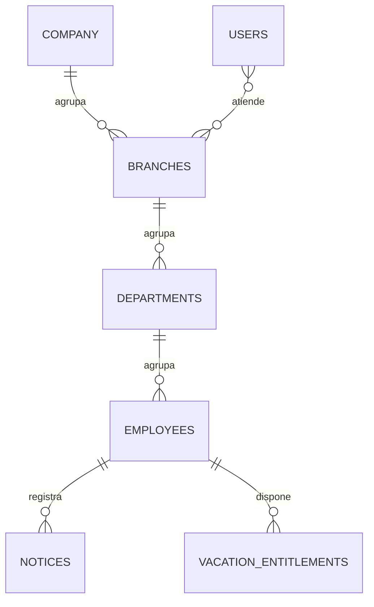

# Arquitectura

Describe la estructura del monorepo, las responsabilidades de cada paquete y los flujos técnicos principales.

[Producto](PRD.md) · [Sistema de diseño](DESIGN_SYSTEM.md) · [Roadmap](ROADMAP.md) · [Instalación y comandos](../README.md)

## Contexto

El sistema permite a Recursos Humanos gestionar empleados, ausencias y saldos de vacaciones por empresa y sede. El navegador consume una API autenticada a través del SDK del proyecto.

La autenticación, los permisos y la auditoría se resuelven en el backend. Las notificaciones actuales se guardan en PostgreSQL. La entrega por correo está pendiente.

## Monorepo

npm workspaces enlaza los tres paquetes y mantiene un lockfile en la raíz.

| Paquete | Responsabilidad | Dependencia |
| --- | --- | --- |
| `backend/` | API Hapi en JavaScript, reglas de negocio y persistencia | PostgreSQL |
| `sdk/` | Cliente TypeScript, contratos y transporte HTTP | API |
| `frontend/` | Aplicación React con Vite | `@vacations/sdk` |

El frontend importa el SDK como paquete del workspace. El SDK se compila antes del frontend. Los contratos compartidos con la interfaz viven en el SDK.

| Directorio | Contenido |
| --- | --- |
| `backend/src/config/` | Configuración y conversión de variables de entorno |
| `backend/src/plugins/` | Módulos de autenticación, organización, ausencias y administración |
| `backend/src/lib/` | Clases CRUD, alcance de datos, auditoría, errores y cálculos |
| `backend/src/db/` | Conexión, migraciones y seeds por dominio |
| `sdk/src/core/` | HTTP, renovación de sesión y errores |
| `sdk/src/resources/` | Operaciones y tipos de cada recurso |
| `frontend/src/app/` | Navegación y estructura de la aplicación |
| `frontend/src/features/` | Páginas, formularios y hooks por dominio |
| `frontend/src/components/` | Componentes visuales compartidos |

## Backend

### Responsabilidades

Cada módulo agrupa rutas, esquemas, servicio, repositorio, modelo y columnas públicas según sus necesidades.

| Capa | Responsabilidad |
| --- | --- |
| Rutas y esquemas | Validar la entrada HTTP, exigir permisos y declarar eventos de auditoría |
| Servicio | Aplicar reglas de negocio y coordinar operaciones |
| Repositorio | Consultar y escribir datos, aplicar filtros y alcance |
| Modelo y columnas | Describir la entidad y los campos expuestos por la API |

Los catálogos comparten `CrudRoutes`, `CrudService` y `CrudRepository`. Los flujos de autenticación, aprobación y saldo tienen operaciones específicas. Los cálculos de periodos, días, horas y festivos se mantienen en funciones reutilizables. [Clases compartidas](../backend/src/lib/crud)

### Consultas y transacciones

Objection y Knex construyen las consultas. Los valores de SQL manual se pasan como parámetros y el ordenamiento acepta columnas de una lista permitida. Las migraciones definen el esquema, las restricciones y los índices. [Consultas de listados](../backend/src/lib/list-query.js), [migraciones](../backend/src/db/migrations)

Al aprobar vacaciones, el backend cambia el estado y descuenta el saldo en una transacción. Bloquea la fila del saldo para serializar los descuentos concurrentes. Cancelar una ausencia aprobada devuelve el consumo registrado. [Servicio de avisos](../backend/src/plugins/notices/service.js), [motor de saldo](../backend/src/plugins/notices/balance.js)

La rotación de refresh tokens y los cambios de contraseña bloquean la fila del usuario y consumen los códigos vigentes dentro de la transacción. [Autenticación](../backend/src/plugins/auth/service.js)

### Errores

La API devuelve `{ error: { code, message } }`. El manejador global traduce los errores de validación, negocio y PostgreSQL, y conserva las cabeceras HTTP relevantes.

| Origen | Respuesta |
| --- | --- |
| Entrada inválida | `400 VALIDATION_ERROR` |
| Regla de negocio | Código de dominio y estado HTTP correspondiente |
| Restricción de PostgreSQL | Conflicto o error de integridad traducido |
| Fallo inesperado | `500 INTERNAL_ERROR` con mensaje genérico |

Los códigos y sus traducciones se centralizan en el catálogo de errores. [Manejador](../backend/src/lib/error-handler.js), [catálogo](../backend/src/lib/error-catalog.js)

## Datos y acceso

La API valida JWT y exige permisos con el formato `modulo:accion`. Los repositorios restringen los datos por sede o empleado. Los servicios también comprueban las referencias al crear o modificar registros. Los turnos, motivos y reglas de acumulación son catálogos globales. [Alcance de datos](../backend/src/lib/data-scope.js)

Los permisos y las sedes se incluyen en el access token. Sus cambios se reflejan al emitir el siguiente token. La comprobación actual de Hapi valida firma y vencimiento. La revocación inmediata y la exigencia del cambio de contraseña temporal desde la API están en el [roadmap](ROADMAP.md#seguridad-e-integridad).

La auditoría registra los eventos declarados por las rutas, incluidos rechazos de negocio y de autorización. Guarda usuario, entidad, resultado e identificador de petición. La IP se obtiene de la conexión y, para proxies confiables, de `X-Forwarded-For`. [Auditoría](../backend/src/lib/audit.js), [resolución de IP](../backend/src/lib/client-ip.js)

## Frontend y SDK

TanStack Query mantiene los datos remotos. Los filtros y la paginación se guardan en la URL. El SDK serializa los parámetros, adjunta el access token y comparte una única renovación entre peticiones que reciben `401`. Las consultas admiten cancelación mediante `AbortSignal`. [Cliente HTTP](../sdk/src/core/http-client.ts), [consultas del frontend](../frontend/src/lib/query-client.ts)

Al guardar cambios, el frontend invalida las consultas para actualizar listas, saldos, calendario e indicadores. Los permisos determinan las opciones del menú y las rutas disponibles. [Navegación](../frontend/src/app/navigation.ts)

La API usa el prefijo `/api/v1`. Los listados CRUD exponen paginación, orden y filtros propios. Swagger y Bruno contienen el detalle de los endpoints. [Registro de la API](../backend/src/server.js), [colección Bruno](../backend/src/doc/bruno)

## Ejecución y calidad

En desarrollo, Vite sirve la interfaz. NGINX puede reenviar las llamadas de la API a Hapi. PostgreSQL puede ejecutarse localmente o con Docker Compose. Las variables y los comandos de arranque están en el [README](../README.md#arranque-rápido).

El backend genera periodos al arrancar y en el intervalo configurado. El proceso es repetible y reporta los empleados omitidos. La ejecución manual requiere permisos administrativos. [Generación de periodos](../backend/src/plugins/vacation-entitlements/rollover.js)

CI usa Node.js 24 y PostgreSQL 17. Ejecuta lint, compilación y pruebas de los tres paquetes. Los cambios de contrato deben mantener compatibles la API, el SDK y el frontend. [Pipeline](../.github/workflows/ci.yml)

## Decisiones y límites actuales

- Las migraciones de Knex son la referencia del esquema y los seeds proporcionan datos de desarrollo.
- Los catálogos usan baja lógica. Las ausencias cambian de estado mediante acciones de negocio.
- PostgreSQL devuelve las columnas `DATE` como texto `AAAA-MM-DD` y `NUMERIC` como números de JavaScript.
- El contador de intentos por IP vive en memoria de cada instancia.
- El despliegue de producción y el envío de correo requieren definición e integración.

## Referencias

Estructura adaptada de arc42 y de las vistas por componentes de Backstage. Diátaxis orienta el contenido según la necesidad del lector. La vista del monorepo describe las dependencias entre paquetes de npm workspaces. [arc42](https://arc42.org/overview/), [Diátaxis](https://diataxis.fr/), [Backstage](https://github.com/backstage/backstage/blob/master/docs/overview/architecture-overview.md), [Turborepo](https://turborepo.dev/docs/crafting-your-repository/structuring-a-repository)
