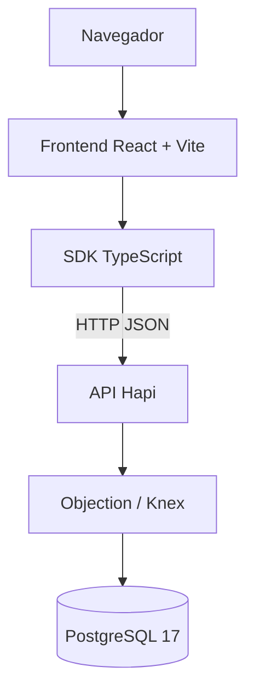
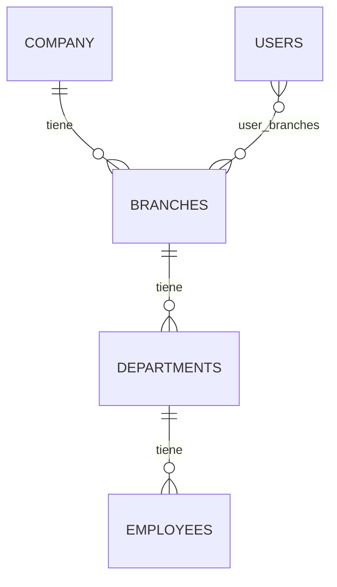
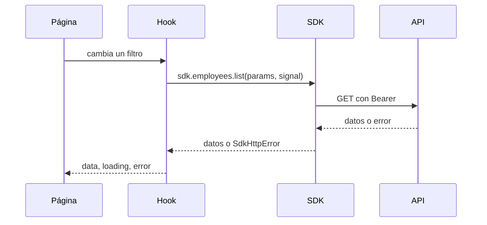

# Arquitectura

## Vista general

Sin servicios externos: login, sesiones y RBAC son propios (plugin `auth`). El correo con Resend está pendiente.

## Monorepo

| Carpeta | Contenido |
|---|---|
| `backend/src/config` | Variables de entorno validadas con un schema |
| `backend/src/db` | Conexión Knex, migraciones y seeds |
| `backend/src/lib` | Clases base, errores, auditoría, alcance de datos y cálculos |
| `backend/src/plugins` | Un módulo por entidad: rutas, schemas, servicio, repositorio y modelo |
| `backend/src/doc/bruno` | Colección Bruno |
| `sdk/src` | `core/` transporte, `resources/` un recurso por entidad, `types/` |
| `frontend/src` | `app/` shell y menú, `components/` kit, `features/` por dominio, `lib/` SDK y sesión |
| `docs` | Este documento, PRD, Design System y Roadmap |

## Backend

### Clases base

| Clase | Archivo | Responsabilidad |
|---|---|---|
| `ApiRoutes` | `lib/api-routes.js` | Plugin de Hapi, permisos y auditoría de cada ruta |
| `CrudRoutes` | `lib/crud/crud-routes.js` | Las cinco rutas del CRUD |
| `CrudService` | `lib/crud/crud-service.js` | Listar, buscar, crear, editar, dar de baja y error "no existe" |
| `CrudRepository` | `lib/crud/crud-repository.js` | Listado con orden y paginación, baja lógica, `applyFilters` y `restrictToScope` |
| `DataScope` | `lib/data-scope.js` | Restringe consultas y valida referencias según el rol |

Cada módulo extiende solo lo que lo distingue y exporta una instancia. Un módulo nuevo necesita:

1. `fields.js` con las columnas públicas y `model.js` con el modelo de Objection.
2. Repositorio y servicio que extienden las clases base.
3. Rutas con `CrudRoutes`, registradas en `server.js`.

Los cálculos sin estado siguen como funciones: `request-breakdown`, `periods`, `holidays`, `balance` y `list-query`.

### Configuración

Todo valor configurable sale de `backend/src/config/index.js`.

| Pieza | Función |
|---|---|
| `GenericValidator` (`lib/generic-validators.js`) | Validadores reutilizables: `positive`, `decimal`, `text`, `flag`, `list`, `timeZone` |
| Schema de `config/index.js` | Valida `process.env` y expone los valores ya convertidos |
| `backend/.env.example` | Lista cada variable con su descripción y valor por defecto |

Una variable inválida detiene el arranque y nombra la variable sin mostrar su valor.

### Errores

| Origen | Resultado |
|---|---|
| Validación Joi | `400 VALIDATION_ERROR` con `lib/validation-messages.js` |
| `AppError` del servicio | Código de negocio con su estado HTTP |
| Error de PostgreSQL | Se traduce por restricción y SQLSTATE; sin traducción, mensaje genérico |
| Cualquier otro | `500 INTERNAL_ERROR` |

Forma única de respuesta: `{ "error": { "code": "...", "message": "..." } }`. Los mensajes al usuario van en español, los de desarrollo en inglés.

### Consultas y transacciones

- Usa Objection o Knex. En `raw`, liga los valores con `?`.
- Identificadores dinámicos: solo desde una lista permitida.
- Filtros, orden y fechas: `lib/list-query.js`. Las fechas son `AAAA-MM-DD` y el rango incluye el último día.
- Una operación en varias tablas abre la transacción en el servicio y pasa `trx` a cada consulta.
- Autenticación bloquea la fila del usuario antes de rotar tokens o cambiar contraseñas.
- Índices y restricciones nuevos van en migraciones, con una prueba del contrato HTTP.

## Datos y alcance

| Rol | Ve | Fuera de alcance |
|---|---|---|
| `SUPERUSER` | Todo | — |
| `USER` | Lo que cuelga de sus sedes | Leer, editar o borrar responde 404; apuntar a un registro ajeno responde 422 |
| `EMPLOYEE` | Lo suyo (`employee_id` del token) | Igual |

- El token lleva `role` y `branch_ids`; un cambio de sedes aplica en el siguiente token.
- Los repositorios usan `DataScope.restrictEmployees`, `restrictDepartments`, `restrictBranches` y `restrictCompanies`; los servicios validan con `allowsEmployee`, `allowsDepartment` y `allowsBranch`.
- Turnos, motivos y reglas son catálogos globales.

## Autenticación y autorización

| Tema | Regla |
|---|---|
| Tokens | Access token JWT de vida corta y refresh token opaco; de este solo se guarda el hash |
| Rotación | Cada refresh token se usa una vez, en una transacción |
| Contraseñas | `bcryptjs`; cambiar o restablecer revoca sesiones y códigos pendientes |
| Bloqueo | Por cuenta tras intentos fallidos seguidos; límite por IP en memoria |
| Permisos | `modulo:accion` en `scope` del token; la ruta los pide con `requires(...)`, basta uno |
| Sin permiso | `403 FORBIDDEN` |
| Cambio de permisos | Aplica en el siguiente access token |

Los tiempos y límites están en `.env.example`.

### Contraseña temporal

| Paso | Regla |
|---|---|
| Alta | `POST /employees` con `email` crea el usuario `EMPLOYEE` en la misma transacción |
| Temporal | `must_change_password = true` y vence según `TEMP_PASSWORD_VALID_MONTHS` |
| Login vencida | `403 TEMPORARY_PASSWORD_EXPIRED` |
| Reenvío | `POST /employees/{id}/access` emite una nueva, desbloquea y cierra sesiones |
| Rechazos | `409 ACCOUNT_NOT_EMPLOYEE` y `409 EMPLOYEE_INACTIVE` |

### Auditoría

`lib/audit.js` es declarativa: cada ruta indica en `options.plugins.audit` el evento, la entidad y el origen del id; un `onPreResponse` guarda la fila.

| Campo | Contenido |
|---|---|
| Quién y qué | Usuario, evento, entidad, id y resultado |
| Contexto | IP, navegador, id de petición y código de error |
| Metadatos | Campos de la petición sin `SECRET_FIELDS` |

- Registra también los rechazos de negocio y los 403.
- Se escribe al responder, no dentro de la transacción, para que un fallo no la deshaga. Si falla, se registra en el log.
- IP real: `lib/client-ip.js` lee `X-Forwarded-For` solo si la conexión viene de `TRUSTED_PROXIES`.
- Solo lectura desde la API.

## Flujos de negocio

| Flujo | Dónde vive | Regla clave |
|---|---|---|
| Solicitud o aviso | `plugins/notices` | `kind` lo decide el servidor según el permiso `notices:create` |
| Cambio de estado | `POST /notices/{id}/approve \| reject \| cancel` | `UPDATE … WHERE status IN (…)`; sin fila afectada, `409 INVALID_TRANSITION` |
| Quién revisa | `users.review_actions` | Sin la acción, `403 REVIEW_ACTION_FORBIDDEN` |
| Cálculo de días y horas | `lib/request-breakdown.js` | Un día equivale a la jornada del turno |
| Saldo | `plugins/notices/balance.js` | Descuenta al aprobar y devuelve al cancelar, con `SELECT … FOR UPDATE` |
| Festivos | `lib/holidays.js` | Art. 74 LFT calculado por año, sin tabla |
| Periodos | `plugins/vacation-entitlements/rollover.js` | Idempotente; corre al arrancar, cada `ROLLOVER_INTERVAL_HOURS` y con `POST /vacation-entitlements/generate` |
| Calendario | `GET /calendar?from&to` | Ausencias del alcance y festivos del rango |
| Notificaciones | tabla `notifications` | Una fila por usuario, tipo y referencia; repetir no duplica |
| Dashboard | `GET /dashboard/summary` y `/dashboard/me` | Una llamada por vista, dentro del alcance |
| PDF | `plugins/notices/pdf.js` | PDFKit, solo avisos aprobados y dentro del alcance |

Las fechas `DATE` salen como texto `AAAA-MM-DD` y `NUMERIC` como número (`src/db/index.js`).

## API

| Recurso | Base `/api/v1` |
|---|---|
| Salud | `/health` |
| Autenticación | `/auth/login`, `/auth/me`, `/auth/me/password`, `/auth/refresh`, `/auth/logout`, `/auth/password-reset/request`, `/auth/password-reset/confirm` |
| Organización | `/companies`, `/branches`, `/departments`, `/employees`, `/shifts` |
| Ausencias | `/notices`, `/reasons`, `/vacation-entitlements`, `/vacation-accrual-rules` |
| Administración | `/users`, `/roles`, `/permissions`, `/role-permissions`, `/auth-audit-log` |
| Vistas | `/calendar`, `/dashboard/summary`, `/dashboard/me`, `/me/notifications` |

- Listados con `page`, `pageSize`, `sort=campo` o `sort=-campo` y filtros propios.
- Los filtros de estado, tipo e ids aceptan varios valores separados por coma o repetidos.
- Rangos de fecha: `from` y `to` en avisos y auditoría; `hired_from` y `hired_to` en empleados.
- `DELETE` es baja lógica: `status = 'inactive'`, o `'cancelled'` en `notices`.
- Detalle por endpoint: Swagger en `/documentation` y la colección Bruno.

## Frontend

- Los datos viven en TanStack Query; filtros y página, en la URL; lo demás, en `useState` o en el contexto de sesión.
- Tras guardar se llama `refreshData()`, porque una aprobación toca solicitudes, saldos, calendario, dashboard y campana.
- Una petición cancelada por un filtro nuevo se aborta con `AbortSignal`.

## Decisiones

| Tema | Decisión |
|---|---|
| Esquema | Solo las migraciones de Knex; los seeds viven en `db/seeds`, un archivo por dominio con prefijo numérico |
| Baja | Lógica: nunca se borra una fila |
| Validación | Joi en el borde HTTP y Objection al escribir en la base |
| SDK | Única puerta al backend; el frontend no usa `fetch` directo |
| Estilos | `styles.css` del prototipo tal cual, sin Tailwind ni librerías de componentes |
| Entorno | Docker Compose para PostgreSQL en desarrollo; CI con PostgreSQL 17 y Node.js 24 |
| Producción | Despliegue pendiente de definir |
